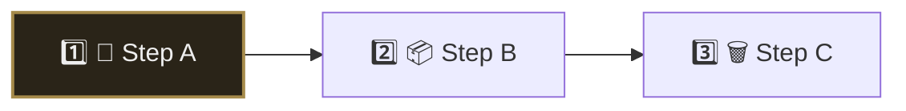
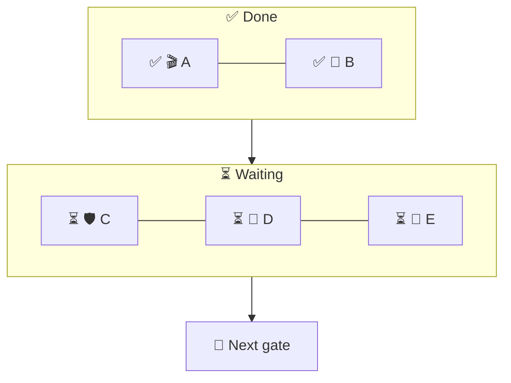

Use until a fuller zoomable mission-control surface ships. Mermaid = durable snapshot for chat + docs hubs. Freeform whiteboard tools = scratch only, not source of truth.

## Why
Owners stay more productive and engaged when status is clear, visual, and easy to scan. Prefer a diagram over a bullet dump for "where are we" / multi-step progress.

## Standing likes (keep these, remix around them)
- Emoji-led every node/subgraph
- Wide peer clusters (`direction LR` + `---`), not tall stacks
- Muted current-step highlight only: `fill:#2a2418,stroke:#a68b4b,stroke-width:2px,color:#eee`
- Two-tier often works: plan strip + detail map
- No neon / pastel yellow / grey-on-light fills

## Keep iterating
Do not freeze the whole diagram. Each status pulse: keep the likes above, change one or two other elements. When the owner stars a new tweak, add it to Standing likes.

## When / rules
One workstream per diagram · concrete nodes · under ~20 · 2–5 prose lines after (blockers + next action only) · no invented progress

## Emoji palette (extend per owner)
Done ✅ · Flight 🔄 · Wait ⏳ · Block 🚫 · User 👤 · Delete 🗑️ · Night 🌙 · Eyes 👀 · Pack 📦 · Absorb 📥 · Twin 🐣 · Steps 1️⃣… · Skip ⏭️

## Preferred starter layout
Two-tier: numbered plan strip (`flowchart LR`, current step muted-highlight) + wide status grid.

### Plan strip

### Wide grid

## Anti-jobs
Don't replace real task SoT with mermaid alone · no neon fills · no tall seat skyscrapers · don't stop iterating once one layout works
